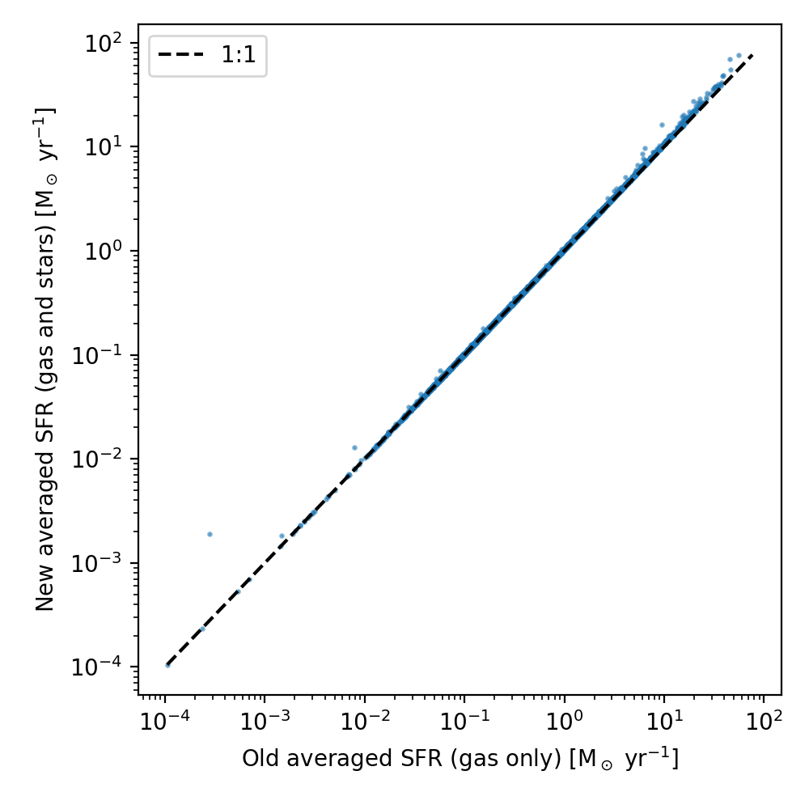
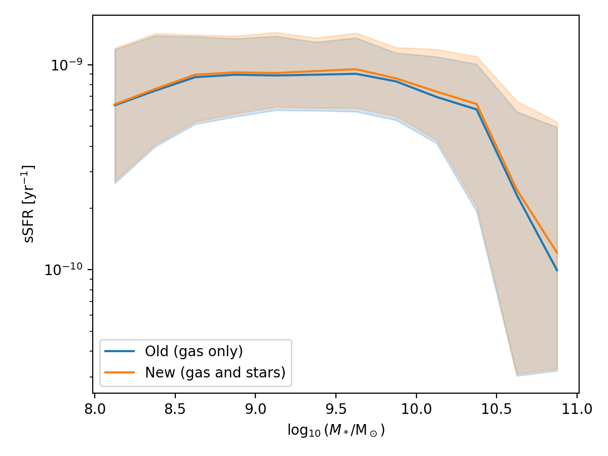

:orphan:

.. _extra_info_avg_sfr_stars:

Star particle contribution to averaged star formation rates
===========================================================

Related to :ref:`issues_averaged_sfr_stars`.
The plots below compare the old (gas only) and new (gas and stars) values of
``AveragedStarFormationRate`` for z=2 of the L50m6, using the 100 Myr window
and the 50 kpc exclusive sphere. They include all subhalos with a stellar mass
above :math:`10^8 M_\odot`.

The first plot compares the values for individual subhalos. Subhalos without a
positive star formation rate are not shown. The median increase when including
the star particles is about 3%, so most subhalos lie close to the one-to-one line.

The second plot shows the specific star formation rate as a function of stellar
mass. The lines show the median and the shaded regions show the 16th to 84th
percentiles. The effect increases with stellar mass, and the median is
about 8% higher for subhalos with stellar masses of :math:`10^{10}-10^{10.5} M_\odot`.

